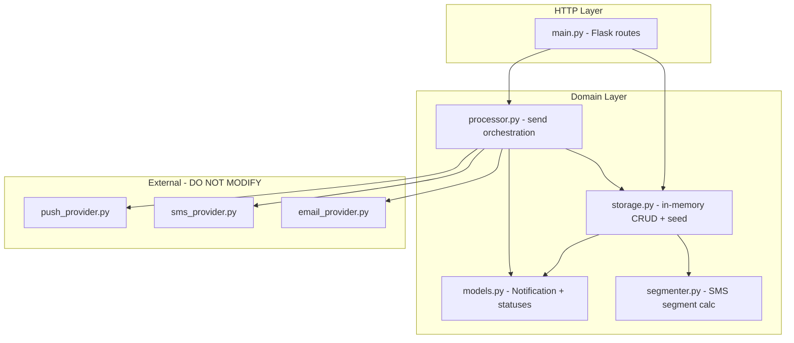
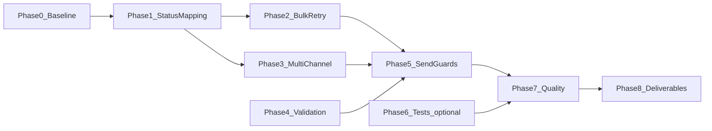

# Notifications API — Implementation Plan

This document is the authoritative roadmap for improving **notifications-api-python**. It covers architecture analysis, gaps, phased work, risks, and open questions. **This is a planning document only — no application code changes are included here.**

---

## 1. Current Architecture



### Request flow

| Operation | Route | Primary modules |
|-----------|-------|-----------------|
| Create | `POST /notifications` | `main.py` → `storage.add_notification()` → optional `segmenter.min_sms_segments()` |
| List / Get | `GET /notifications`, `GET /notifications/<id>` | `storage.get_all()` / `find_by_id()` |
| Update | `PUT /notifications/<id>` | `find_by_id()` + unrestricted `setattr` loop |
| Send one | `POST /notifications/<id>/send` | `processor.send_one()` |
| Send bulk | `POST /notifications/send-bulk` | `processor.send_all()` |

### Design characteristics

- **In-memory only** — module-level list in `src/storage.py`; restart resets to seed data.
- **Synchronous delivery** — provider calls block inside the HTTP request; no queue or background workers.
- **Single dependency** — Flask 3.x only (`requirements.txt`).
- **No auth, persistence, or automated tests.**
- **Providers are simulated vendor APIs** — probabilistic `Success` / `TemporaryFailure` / `PermanentFailure` / `InvalidRequest` responses; **must not be edited** per `SPEC.md` and project hooks.

### Status model (defined vs. used)

`src/models.py` defines five statuses: `pending`, `processing`, `sent`, `retry_pending`, `failed`.

Seed data in `src/storage.py` demonstrates all five, but `src/processor.py` only transitions to `processing`, `sent`, or `failed` (missing channels / unknown channel). **`retry_pending` is never set at runtime**, and provider failure results are ignored.

---

## 2. Issues, Gaps, and Technical Debt

### Critical bugs (delivery correctness)

| Issue | Location | Impact |
|-------|----------|--------|
| Provider `Result` ignored | `processor.py:33-34` | All successful provider calls **and** failures mark notification `sent` |
| `TemporaryFailure` not mapped to `retry_pending` | `processor.py` | Bulk retry semantics broken; seed `n5` never retried by bulk |
| `PermanentFailure` / `InvalidRequest` not mapped to `failed` | `processor.py` | Permanent failures appear as success |
| Success messages stored in `lastError` | `processor.py:34` | Misleading field semantics on success |
| Only first channel used | `processor.py:20` | Multi-channel seed records (`n4`, `n5`) never deliver to all targets |
| Bulk send filters `pending` only | `processor.py:37` | `retry_pending` notifications skipped |

### API / validation gaps

| Issue | Location | Impact |
|-------|----------|--------|
| No validation on create | `main.py:14-17` | Missing/malformed JSON → 500 instead of 400 |
| Unrestricted PUT updates | `main.py:38-39` | Clients can overwrite `id`, `status`, `attempts`, etc. |
| No send guards | `main.py` + `processor.py` | Can re-send `sent` notifications; increments attempts silently |
| No error handler for `request.json` being `None` | `main.py` | Empty body crashes |

### Dead / underused code

| Item | Notes |
|------|-------|
| `smsSegments` | Computed on create in `storage.py` but never read by processor or API consumers |
| `segmenter.py` | Works correctly in isolation; no integration beyond storage |
| `RETRY_PENDING` constant | Imported in storage for seed only; processor never imports it |

### Operational / quality debt

- Flask debug mode enabled by default (`app.run(port=3000)` with no `debug=False`).
- No automated test suite; verification is manual only (`AGENTS.md`).
- No CI configuration.
- Import style assumes running `python src/main.py` from repo root (not package-relative).
- Python version not pinned.

### Hard constraints (non-negotiable)

From `SPEC.md`, `AGENTS.md`, and `.cursor/hooks/`:

- **Do not modify** anything under `src/providers/`.
- **README narrative** (issues, approach, AI tool usage) must be **hand-written by the candidate** — AI may not draft that text.
- **Ask before**: new dependencies, API response format changes, route renames, persistent storage, seed data changes affecting tests, git push/branches.

---

## 3. Assumptions and Risks

### Assumptions (to validate before coding)

1. Improvements should stay within the existing route surface and in-memory architecture unless explicitly approved.
2. Provider response contract (`Result`, `ErrorCode`, `Message`) is stable and authoritative.
3. Seed data is illustrative; changing it is low priority unless tests depend on it.
4. Screening evaluators expect **bug fixes and sensible delivery semantics**, not a full production rewrite.

### Project risks

| Risk | Mitigation |
|------|------------|
| Multi-channel semantics are unspecified | Decide and document strategy in Phase 3 before coding |
| Fixing status mapping changes observable API behavior | Treat as bug fix; verify with manual curl; note in hand-written README |
| Renaming `lastError` would break API contract | Keep field name; only change when it is populated (ask before adding new fields) |
| Random provider outcomes make deterministic testing hard | Mock provider imports in tests, or run statistical manual checks |
| Adding pytest requires dependency approval | Phase 6 is optional pending approval |

---

## 4. Implementation Phases

### Phase 0 — Baseline and verification harness

**Goal:** Establish a reproducible baseline before changing behavior.

**Required changes:**
- Run app locally (`py -m pip install -r requirements.txt` → `py src/main.py`).
- Capture baseline behavior for all six endpoints (document in personal notes or `NOTES.md` — already partially done).
- Create a manual test script or curl checklist (can live in this document's appendix or personal notes; not README).

**Dependencies:** None.

**Risks:** Random provider outcomes require multiple send attempts to observe all result types.

**Acceptance criteria:**
- Server starts on port 3000 with 5 seeded notifications.
- Documented evidence that failed/temporary provider responses currently yield `status: "sent"` (confirms Phase 1 scope).

---

### Phase 1 — Provider response → status mapping (highest priority)

**Goal:** Make notification status reflect provider delivery outcomes.

**Required changes in `src/processor.py`:**
- After provider call, branch on `response["Result"]`:
  - `Success` → `SENT`; clear or set informational message appropriately
  - `TemporaryFailure` → `RETRY_PENDING`; store `Message` in `lastError`
  - `PermanentFailure` / `InvalidRequest` → `FAILED`; store `Message` in `lastError`
- Import `RETRY_PENDING` from `models`.
- Extract a small helper (e.g. `_apply_provider_response(n, response)`) to keep `send_one` readable — inline is also acceptable given project size.

**Dependencies:** Phase 0 baseline.

**Risks:**
- Success messages in `lastError` today may be relied on informally; decide whether to clear `lastError` on success or keep last provider message (recommend: clear on success, set only on non-success — document in README).

**Acceptance criteria:**
- Manual sends eventually produce `sent`, `retry_pending`, and `failed` matching provider `Result`.
- `attempts` and `lastAttemptAt` still increment/update on each send.
- `processing` is set at start of send (existing behavior preserved).
- Single-channel email/sms/push paths unchanged except status mapping.

**Verification commands:**
```bash
# Repeat until each status observed (providers are random)
curl -X POST http://localhost:3000/notifications/2/send
curl -X POST http://localhost:3000/notifications/3/send
```

---

### Phase 2 — Bulk send and retry semantics

**Goal:** Align bulk delivery with the status lifecycle implied by seed data.

**Required changes in `src/processor.py`:**
- Update `send_all()` filter to include notifications where `status in (PENDING, RETRY_PENDING)`.
- Optionally exclude `PROCESSING` (should not occur in single-threaded sync flow, but safe guard).

**Dependencies:** Phase 1 (retry_pending must be set correctly first).

**Risks:** Bulk may now re-process notifications that were manually set to `retry_pending` in seed (`n5`) — this is desired behavior.

**Acceptance criteria:**
- `POST /notifications/send-bulk` processes seed `n2` (pending), `n4` (pending), and `n5` (retry_pending).
- Already `sent` / `failed` seed records are skipped.
- Response returns full notification list with updated statuses.

---

### Phase 3 — Multi-channel delivery

**Goal:** Deliver to all configured channels, not only `targetChannels[0]`.

**Required changes in `src/processor.py`:**
- Replace single-target logic with iteration over `n.targetChannels`.
- Dispatch to correct provider per channel `type`.
- Aggregate results into a final notification status.

**Recommended strategy (pending confirmation — see Section 5):**

*Option A — All channels must succeed:*
- Final status `SENT` only if every channel returns `Success`.
- Any `TemporaryFailure` → `RETRY_PENDING` (retry all on next send).
- Any `PermanentFailure` / `InvalidRequest` → `FAILED`.

*Option B — First success wins (failover):*
- Try channels in order; stop on first `Success` → `SENT`.
- All failures → `FAILED` or `RETRY_PENDING` if any temporary.

*Option C — Independent per-channel (requires API shape change):*
- Store per-channel results — **likely out of scope** without API format approval.

**Default recommendation:** Option A — matches seed data where notifications list multiple channels as simultaneous targets.

**Dependencies:** Phase 1.

**Risks:**
- Increases provider calls per send (3x for `n5`); acceptable for in-memory demo.
- Partial failure aggregation rules must be documented.

**Acceptance criteria:**
- Sending `n4` or `n5` invokes multiple provider calls (observable via consistent multi-prefix messages in `lastError` or logs if added).
- Final status follows chosen aggregation rules.
- Unknown channel type still fails the notification.

---

### Phase 4 — Input validation and update safety

**Goal:** Return predictable 400 errors and prevent unsafe field mutation.

**Required changes:**

`src/main.py`:
- Validate `POST /notifications` body: require `message` (non-empty string) and `targetChannels` (non-empty list of `{type, value}` dicts).
- Validate channel `type` is one of `email`, `sms`, `push`; `value` non-empty.
- Guard `request.json is None` on POST/PUT.
- Restrict `PUT` to an allowlist: e.g. `message`, `targetChannels` only (not `id`, `status`, `attempts`, `createdAt`, etc.).

Optional new module `src/validation.py` if logic grows; otherwise keep helpers in `main.py` per AGENTS simplicity guideline.

`src/storage.py`:
- Recompute `smsSegments` when `message` or SMS channels change via PUT (currently only set on create).

**Dependencies:** None strictly, but best after Phase 1–3 so send behavior is stable.

**Risks:**
- Stricter validation may reject requests that previously "worked" with bad data (e.g. seed `n2` SMS number `"12345"` is invalid per provider — already fails at provider level).

**Acceptance criteria:**
- `POST /notifications` with missing fields → 400 with `{ "error": "..." }`.
- `PUT` cannot change `status` or `id`.
- Invalid channel type on create → 400.

---

### Phase 5 — Send guards and HTTP hardening

**Goal:** Prevent nonsensical send operations and improve dev-server defaults.

**Required changes:**

`src/processor.py` or `src/main.py`:
- Define policy for sending non-pending notifications:
  - **Recommended:** Allow manual resend of `retry_pending` and `failed`; reject or no-op `sent` (return 409 or 400 with message — prefer 409 to signal conflict without changing response shape of success path).
  - **Alternative:** Allow resend of anything except `processing`.

`src/main.py`:
- Set `debug=False` in `app.run()` (or document why debug stays on).

**Dependencies:** Phases 1–2.

**Risks:** Rejecting resend of `sent` notifications changes behavior for clients that currently re-post send on id=1.

**Acceptance criteria:**
- Sending a `sent` notification returns appropriate error (if policy chosen).
- Sending `retry_pending` succeeds and increments attempts.
- Server starts without Flask debug reloader unless explicitly enabled.

---

### Phase 6 — Automated tests (optional, requires approval)

**Goal:** Lock in processor and validation behavior with deterministic tests.

**Required changes:**
- Add `pytest` to `requirements.txt` — **ask first**.
- Create `tests/` directory:
  - `tests/test_processor.py` — mock `providers.*.send` to return fixed responses; assert status transitions.
  - `tests/test_validation.py` — test allowlist and create validation (if extracted).
  - `tests/test_segmenter.py` — unit tests for edge cases (empty message, long words, 160-char boundary).

**Dependencies:** Phases 1–4.

**Risks:** New dependency; test maintenance burden.

**Acceptance criteria:**
- `pytest` passes locally without hitting real random providers.
- Coverage of: success/temp/permanent/invalid mapping, bulk filter, multi-channel aggregation.

---

### Phase 7 — Code quality pass

**Goal:** Small refactors without behavior changes.

**Required changes:**
- Deduplicate provider dispatch (`type` → `send_*` function map) in `processor.py`.
- Consider typed dict or constants for allowed channel types (match existing style — minimal typing).
- Run `/pr-review-toolkit` before push (`.cursor-plugin/`).
- Remove any dead imports; ensure comments explain non-obvious aggregation rules only.

**Dependencies:** Phases 1–5 complete.

**Risks:** Over-abstraction — keep map dict inline if <10 lines.

**Acceptance criteria:**
- No behavior change vs. Phase 5 verification checklist.
- Review agents report no critical issues.

---

### Phase 8 — Candidate deliverables (non-code)

**Goal:** Satisfy `SPEC.md` submission requirements.

**Required changes (candidate-owned):**
- **Hand-write** README additions: issues found, what was implemented, rationale, AI tools used for coding.
- Push final code to private repository — **ask before push** per AGENTS.md.
- Submit repository URL via assignment form.

**Dependencies:** All coding phases complete and manually verified.

**Risks:** README must not be AI-generated (screening rule).

**Acceptance criteria:**
- README sections complete and in candidate's own words.
- Remote repository contains all code changes; providers untouched.

---

## 5. Unclear Requirements — Clarify Before Coding

These should be resolved with the assigner or team before Phases 3 and 5:

1. **Multi-channel send semantics** — Must all channels succeed (Option A), first success wins (Option B), or per-channel tracking (Option C)?
2. **Resend policy** — Should `POST .../send` on an already-`sent` notification be allowed, rejected, or idempotent no-op?
3. **Max retry attempts** — Should `retry_pending` eventually transition to `failed` after N attempts, or retry indefinitely on manual/bulk send?
4. **`lastError` on success** — Clear the field, keep last message, or add a separate field (would need API approval)?
5. **`smsSegments` purpose** — Display-only metadata, validation gate (reject over N segments), or billing integration?
6. **Automated tests** — Expected for screening submission, or manual verification sufficient?
7. **API error format** — Standardize all errors as `{ "error": "..." }` with 400/404/409, or minimal changes only?

**Recommended defaults if no answer:** Option A multi-channel, reject resend of `sent`, no max retry cap, clear `lastError` on success, keep `smsSegments` as metadata only, skip pytest unless approved, use `{ "error": "..." }` for new validation errors only.

---

## 6. Suggested Implementation Order



**Minimum viable improvement (MVP):** Phases 0 → 1 → 2 → manual verification → Phase 8 README.

**Recommended full scope:** Phases 0–5 + 7, with Phase 6 if pytest approved.

---

## 7. Manual Verification Checklist (post-implementation)

| Check | Expected |
|-------|----------|
| `GET /notifications` | 5 seeded records, mixed statuses |
| `GET /notifications/999` | 404 |
| `POST /notifications` valid body | 201/200 with new id, `smsSegments` set when SMS present |
| `POST /notifications` invalid body | 400 |
| `PUT /notifications/1` `{ "status": "pending" }` | Ignored or 400 (after Phase 4) |
| `POST /notifications/2/send` | Status reflects provider (not always `sent`) |
| `POST /notifications/send-bulk` | Pending + retry_pending processed |
| Multi-channel send (`n4`, `n5`) | All channels attempted (after Phase 3) |
| Provider files | Unchanged git diff under `src/providers/` |

---

## 8. Files Expected to Change

| File | Phases |
|------|--------|
| `src/processor.py` | 1, 2, 3, 5, 7 |
| `src/main.py` | 4, 5 |
| `src/storage.py` | 4 (smsSegments on update) |
| `src/validation.py` | 4 (optional new file) |
| `tests/*` | 6 (optional) |
| `requirements.txt` | 6 (optional, with approval) |
| `README.md` | 8 (candidate hand-written) |
| `PLAN.md` | This document |
| **`src/providers/*`** | **Never** |

---

## 9. Out of Scope (unless explicitly requested)

- Persistent storage (database, file)
- Authentication / authorization
- Async job queue or worker pool
- New HTTP routes (e.g. filter by status, delete notification)
- Provider file changes or vendor API simulation tweaks
- AI-authored README content
