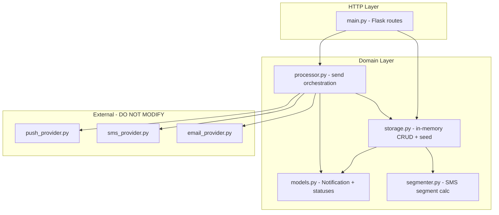
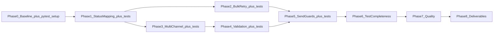

# Notifications API — Implementation Plan

This document is the authoritative roadmap for improving **notifications-api-python**. It covers architecture analysis, gaps, phased work, risks, and resolved decisions. **This is a planning document only — no application code changes are included here.**

---

## 1. Current Architecture



### Request flow

| Operation | Route | Primary modules |
|-----------|-------|-----------------|
| Create | `POST /notifications` | `main.py` → `storage.add_notification()` → optional `segmenter.min_sms_segments()` |
| List / Get | `GET /notifications`, `GET /notifications/<id>` | `storage.get_all()` / `find_by_id()` |
| Update | `PUT /notifications/<id>` | `find_by_id()` + unrestricted `setattr` loop |
| Send one | `POST /notifications/<id>/send` | `processor.send_one()` |
| Send bulk | `POST /notifications/send-bulk` | `processor.send_all()` |

### Design characteristics

- **In-memory only** — module-level list in `src/storage.py`; restart resets to seed data.
- **Synchronous delivery** — provider calls block inside the HTTP request; no queue or background workers.
- **Dependencies** — Flask 3.x (`requirements.txt`); pytest added in Phase 0 (decided for this task).
- **No auth or persistence** — automated tests added per Section 5.
- **Providers are simulated vendor APIs** — probabilistic `Success` / `TemporaryFailure` / `PermanentFailure` / `InvalidRequest` responses; **must not be edited** per `SPEC.md` and project hooks.

### Status model (defined vs. used)

`src/models.py` defines five statuses: `pending`, `processing`, `sent`, `retry_pending`, `failed`.

Seed data in `src/storage.py` demonstrates all five, but `src/processor.py` only transitions to `processing`, `sent`, or `failed` (missing channels / unknown channel). **`retry_pending` is never set at runtime**, and provider failure results are ignored.

---

## 2. Issues, Gaps, and Technical Debt

### Critical bugs (delivery correctness)

| Issue | Location | Impact |
|-------|----------|--------|
| Provider `Result` ignored | `processor.py:33-34` | All successful provider calls **and** failures mark notification `sent` |
| `TemporaryFailure` not mapped to `retry_pending` | `processor.py` | Bulk retry semantics broken; seed `n5` never retried by bulk |
| `PermanentFailure` / `InvalidRequest` not mapped to `failed` | `processor.py` | Permanent failures appear as success |
| Success messages stored in `lastError` | `processor.py:34` | Misleading field semantics on success |
| Only first channel used | `processor.py:20` | Multi-channel seed records (`n4`, `n5`) never deliver to all targets |
| Bulk send filters `pending` only | `processor.py:37` | `retry_pending` notifications skipped |

### API / validation gaps

| Issue | Location | Impact |
|-------|----------|--------|
| No validation on create | `main.py:14-17` | Missing/malformed JSON → 500 instead of 400 |
| Unrestricted PUT updates | `main.py:38-39` | Clients can overwrite `id`, `status`, `attempts`, etc. |
| No send guards | `main.py` + `processor.py` | Can re-send `sent` notifications; increments attempts silently |
| No error handler for `request.json` being `None` | `main.py` | Empty body crashes |

### Dead / underused code

| Item | Notes |
|------|-------|
| `smsSegments` | Computed on create in `storage.py` but never read by processor or API consumers |
| `segmenter.py` | Works correctly in isolation; no integration beyond storage |
| `RETRY_PENDING` constant | Imported in storage for seed only; processor never imports it |

### Operational / quality debt

- Flask debug mode enabled by default (`app.run(port=3000)` with no `debug=False`).
- No automated test suite yet; pytest suite planned in Phases 0–6 (see Section 5).
- No CI configuration.
- Import style assumes running `python src/main.py` from repo root (not package-relative).
- Python version not pinned.

### Hard constraints (non-negotiable)

From `SPEC.md`, `AGENTS.md`, and `.cursor/hooks/`:

- **Do not modify** anything under `src/providers/`.
- **README narrative** (issues, approach, AI tool usage) must be **hand-written by the candidate** — AI may not draft that text.
- **Ask before**: API response format changes, route renames, persistent storage, seed data changes affecting tests, git push/branches. (pytest dependency is pre-approved — see Section 5 Decision #6.)

---

## 3. Assumptions and Risks

### Assumptions (to validate before coding)

1. Improvements should stay within the existing route surface and in-memory architecture unless explicitly approved.
2. Provider response contract (`Result`, `ErrorCode`, `Message`) is stable and authoritative.
3. Seed data is illustrative; changing it is low priority unless tests depend on it.
4. Screening evaluators expect **bug fixes and sensible delivery semantics**, not a full production rewrite.

### Project risks

| Risk | Mitigation |
|------|------------|
| Multi-channel semantics | Option A documented in Section 5 |
| Fixing status mapping changes observable API behavior | Treat as bug fix; verify with manual curl and `pytest`; note in hand-written README |
| Renaming `lastError` would break API contract | Keep field name; only change when it is populated (ask before adding new fields) |
| Random provider outcomes make deterministic testing hard | Mock `providers.*.send` in unit tests; use manual curl for integration smoke checks |
| Test maintenance burden | Keep tests focused on processor, validation, segmenter; run `pytest` after each phase |

---

## 4. Implementation Phases

### Phase 0 — Baseline, pytest setup, and verification harness

**Goal:** Establish a reproducible baseline before changing behavior; scaffold the test suite.

**TDD setup (first step of this phase):**
- Add `pytest` to `requirements.txt` (decided for this task — no further approval needed).
- Create `tests/` with `conftest.py` (fixtures for `Notification`, mocked providers).

**Required changes:**
- Run app locally (`py -m pip install -r requirements.txt` → `py src/main.py`).
- Capture baseline behavior for all six endpoints (document in personal notes or `NOTES.md` — already partially done).
- Create a manual test script or curl checklist (can live in this document's appendix or personal notes; not README).

**Dependencies:** None.

**Risks:** Random provider outcomes require multiple send attempts to observe all result types.

**Acceptance criteria:**
- Server starts on port 3000 with 5 seeded notifications.
- Documented evidence that failed/temporary provider responses currently yield `status: "sent"` (confirms Phase 1 scope).
- `tests/` directory exists; `pytest` runs (may have zero or placeholder tests).

---

### Phase 1 — Provider response → status mapping (highest priority)

**Goal:** Make notification status reflect provider delivery outcomes.

**TDD steps:**
1. Write failing tests in `tests/test_processor_status_mapping.py` (mock providers; assert status transitions for Success / TemporaryFailure / PermanentFailure / InvalidRequest).
2. Implement mapping in `src/processor.py`.
3. Run `pytest` before Phase 2.

**Required changes in `src/processor.py`:**
- After provider call, branch on `response["Result"]`:
  - `Success` → `SENT`; clear `lastError` (Section 5 Decision #4)
  - `TemporaryFailure` → `RETRY_PENDING`; store `Message` in `lastError`
  - `PermanentFailure` / `InvalidRequest` → `FAILED`; store `Message` in `lastError`
- Import `RETRY_PENDING` from `models`.
- Extract a small helper (e.g. `_apply_provider_response(n, response)`) to keep `send_one` readable — inline is also acceptable given project size.

**Dependencies:** Phase 0 baseline.

**Risks:**
- Success messages in `lastError` today may be relied on informally; clearing on success is the decided policy (Section 5).

**Acceptance criteria:**
- `pytest` tests pass for all four provider `Result` types.
- Manual sends eventually produce `sent`, `retry_pending`, and `failed` matching provider `Result`.
- `attempts` and `lastAttemptAt` still increment/update on each send (including immediate failures such as empty `targetChannels` — keep current behavior).
- `processing` is set at start of send (existing behavior preserved).
- Single-channel email/sms/push paths unchanged except status mapping.

**Verification commands:**
```bash
# Repeat until each status observed (providers are random)
curl -X POST http://localhost:3000/notifications/2/send
curl -X POST http://localhost:3000/notifications/3/send
```

---

### Phase 2 — Bulk send and retry semantics

**Goal:** Align bulk delivery with the status lifecycle implied by seed data.

**TDD steps:**
1. Write failing tests in `tests/test_processor_bulk.py` (assert `send_all()` includes `retry_pending`).
2. Update `send_all()` filter in `src/processor.py`.
3. Run `pytest` before Phase 3.

**Required changes in `src/processor.py`:**
- Update `send_all()` filter to include notifications where `status in (PENDING, RETRY_PENDING)`.
- Optionally exclude `PROCESSING` (should not occur in single-threaded sync flow, but safe guard).

**Dependencies:** Phase 1 (retry_pending must be set correctly first).

**Risks:** Bulk may now re-process notifications that were manually set to `retry_pending` in seed (`n5`) — this is desired behavior.

**Acceptance criteria:**
- `pytest` bulk tests pass.
- `POST /notifications/send-bulk` processes seed `n2` (pending), `n4` (pending), and `n5` (retry_pending).
- Already `sent` / `failed` seed records are skipped.
- Response returns full notification list with updated statuses.

---

### Phase 3 — Multi-channel delivery

**Goal:** Deliver to all configured channels, not only `targetChannels[0]`.

**TDD steps:**
1. Write failing tests in `tests/test_processor_multichannel.py` (Option A aggregation; `lastError` joining).
2. Implement channel iteration and aggregation in `src/processor.py`.
3. Run `pytest` before Phase 4.

**Required changes in `src/processor.py`:**
- Replace single-target logic with iteration over `n.targetChannels`.
- Dispatch to correct provider per channel `type`.
- Aggregate results into a final notification status.

**Strategy (resolved — Option A, see Section 5):**
- SENT: all channels returned Success.
- RETRY_PENDING: at least one channel returned TemporaryFailure.
- FAILED: all remaining cases (PermanentFailure / InvalidRequest and no TemporaryFailure).
- Options B/C (failover, per-channel tracking) rejected — see Section 5.

**`lastError` aggregation (Option A):**
- On SENT: clear `lastError`.
- On RETRY_PENDING or FAILED: join all non-success provider `Message` values with `"; "` in `targetChannels` order (preserve `[email]`, `[sms]`, `[push]` prefixes).
- Example: SMS temporary + email permanent → `retry_pending`, `lastError` = `"[sms] temporary outage; [email] address rejected"`.
- Unknown channel type: include `"Unknown channel: <type>"` in the joined string; treat as failure for aggregation.

**Dependencies:** Phase 1.

**Risks:**
- Increases provider calls per send (3x for `n5`); acceptable for in-memory demo.

**Acceptance criteria:**
- `pytest` multi-channel tests pass.
- Sending `n4` or `n5` invokes multiple provider calls (observable via joined `lastError` messages).
- Final status and `lastError` follow Option A rules.
- Unknown channel type still fails the notification.

---

### Phase 4 — Input validation and update safety

**Goal:** Return predictable 400 errors and prevent unsafe field mutation.

**TDD steps:**
1. Write failing tests in `tests/test_validation.py` (missing fields, invalid channels, PUT allowlist).
2. Implement validation in `src/main.py` (or `src/validation.py` if logic grows).
3. Run `pytest` before Phase 5.

**Required changes:**

`src/main.py`:
- Validate `POST /notifications` body: require `message` (non-empty string) and `targetChannels` (non-empty list of `{type, value}` dicts).
- Validate channel `type` is one of `email`, `sms`, `push`; `value` non-empty.
- Guard `request.json is None` on POST/PUT.
- Restrict `PUT` to an allowlist: e.g. `message`, `targetChannels` only (not `id`, `status`, `attempts`, `createdAt`, etc.).

Optional new module `src/validation.py` if logic grows; otherwise keep helpers in `main.py` per AGENTS simplicity guideline.

`src/storage.py`:
- Recompute `smsSegments` when `message` or SMS channels change via PUT (currently only set on create).

**Dependencies:** Phase 3 (validation after delivery logic is stable).

**Risks:**
- Stricter validation may reject requests that previously "worked" with bad data (e.g. seed `n2` SMS number `"12345"` is invalid per provider — already fails at provider level).

**Acceptance criteria:**
- `pytest` validation tests pass.
- `POST /notifications` with missing fields → 400 with `{ "error": "..." }`.
- `PUT` cannot change `status` or `id`.
- Invalid channel type on create → 400.

---

### Phase 5 — Send guards and HTTP hardening

**Goal:** Prevent nonsensical send operations and improve dev-server defaults.

**TDD steps:**
1. Write failing tests in `tests/test_send_guards.py` (409 for `sent` resend; 200 on delivery failure).
2. Implement guards in `src/main.py` or `src/processor.py`.
3. Run `pytest` before Phase 6.

**Required changes:**

`src/main.py` (or `src/processor.py`):
- **Resend policy (decided):** Allow manual resend of `retry_pending` and `failed`; reject `sent` with **HTTP 409** and `{ "error": "notification already sent" }` (or similar).

**HTTP semantics (see Section 5 Decisions #9–10):**

| Endpoint / case | HTTP status | Response body |
|-----------------|-------------|---------------|
| `POST /notifications/<id>/send` — delivery ends `sent`, `retry_pending`, or `failed` | **200** | Updated notification object |
| `POST /notifications/<id>/send` — notification already `sent` | **409** | `{ "error": "..." }` |
| `POST /notifications/<id>/send` — not found | **404** | `{ "error": "not found" }` |
| `POST /notifications` — valid create | **200** | New notification object |
| `POST /notifications` — validation failure | **400** | `{ "error": "..." }` |
| `PUT /notifications/<id>` — disallowed field | **400** | `{ "error": "..." }` |

`src/main.py`:
- Set `debug=False` in `app.run()` (or document why debug stays on).

**Dependencies:** Phases 2 and 4.

**Risks:** Rejecting resend of `sent` notifications changes behavior for clients that currently re-post send on id=1.

**Acceptance criteria:**
- `pytest` send-guard tests pass.
- Sending a `sent` notification returns 409 with `{ "error": "..." }`.
- Sending `retry_pending` or `failed` succeeds (200) and increments attempts.
- Delivery ending in `failed` or `retry_pending` still returns 200 with updated notification body.
- Server starts without Flask debug reloader unless explicitly enabled.

---

### Phase 6 — Test suite completeness

**Goal:** Close coverage gaps; ensure full suite passes before quality pass.

**Required changes:**
- Add `tests/test_segmenter.py` — edge cases (empty message, long words, 160-char boundary).
- Run full `pytest` suite; fill any remaining gaps from Phases 1–5.
- Confirm coverage of: success/temp/permanent/invalid mapping, bulk filter, multi-channel aggregation, validation, send guards.

**Dependencies:** Phases 1–5.

**Risks:** None beyond routine test maintenance.

**Acceptance criteria:**
- `pytest` passes locally without hitting real random providers.
- Segmenter edge cases covered.

---

### Phase 7 — Code quality pass

**Goal:** Small refactors without behavior changes.

**Required changes:**
- Deduplicate provider dispatch (`type` → `send_*` function map) in `processor.py`.
- Consider typed dict or constants for allowed channel types (match existing style — minimal typing).
- Run `/pr-review-toolkit` before push (`.cursor-plugin/`).
- Remove any dead imports; ensure comments explain non-obvious aggregation rules only.

**Dependencies:** Phases 1–6 complete.

**Risks:** Over-abstraction — keep map dict inline if <10 lines.

**Acceptance criteria:**
- No behavior change vs. Phase 5 verification checklist.
- `pytest` still passes.
- Review agents report no critical issues.

---

### Phase 8 — Candidate deliverables (non-code)

**Goal:** Satisfy `SPEC.md` submission requirements.

**Required changes (candidate-owned):**
- **Hand-write** README additions: issues found, what was implemented, rationale, AI tools used for coding.
- Push final code to private repository — **ask before push** per AGENTS.md.
- Submit repository URL via assignment form.

**Dependencies:** All coding phases complete, `pytest` green, and manually verified.

**Risks:** README must not be AI-generated (screening rule).

**Acceptance criteria:**
- README sections complete and in candidate's own words.
- Remote repository contains all code changes; providers untouched.

---

## 5. Resolved Design Decisions

All ambiguities below are resolved for this implementation. Reference this section from phases instead of re-opening questions.

| # | Topic | Decision | Rationale |
|---|-------|----------|-----------|
| 1 | Multi-channel send | **Option A** — all channels must succeed for `sent`; any `TemporaryFailure` → `retry_pending`; else `failed` | Notification is one logical delivery across all configured channels |
| 2 | Resend policy | Reject resend of `sent` with **HTTP 409**; allow resend of `retry_pending` and `failed` | Prevents duplicate external delivery |
| 3 | Max retry attempts | No cap — `retry_pending` retried via manual send or bulk | Keeps in-memory implementation simple |
| 4 | `lastError` on success | Clear on `sent`; set on `retry_pending` / `failed` only | Avoids misleading error state after success |
| 5 | `smsSegments` | Display-only metadata; no validation gate | Informational; not billing enforcement |
| 6 | Automated tests | **pytest required**; **TDD per phase** (failing test → implement → green); mock providers in unit tests | Deterministic coverage; `pytest` approved for this task |
| 7 | API error format | `{ "error": "message" }` for 400, 404, 409 | Predictable client error handling |
| 8 | Multi-channel `lastError` | Join non-success messages with `"; "` in channel order | Preserves all failure context |
| 9 | Send HTTP on delivery failure | **200** with updated notification body (`failed` / `retry_pending` are valid send outcomes) | Success path response shape unchanged |
| 10 | POST create status code | **200** (Flask default) | No API response format change without approval |

### TDD workflow (applies to Phases 1–5)

1. Write failing pytest cases for the phase scope.
2. Implement minimal code to pass.
3. Run `pytest` before starting the next phase.
4. Phase 6 adds segmenter tests and closes any coverage gaps.

---

## 6. Suggested Implementation Order



**Minimum viable improvement (MVP):** Phases 0 → 1 → 2 (each with tests) → manual verification → Phase 8 README.

**Recommended full scope:** Phases 0–7 (TDD integrated per phase), then Phase 8 deliverables.

---

## 7. Manual Verification Checklist (post-implementation)

| Check | Expected |
|-------|----------|
| `GET /notifications` | 5 seeded records, mixed statuses |
| `GET /notifications/999` | 404 |
| `POST /notifications` valid body | **200** with new id, `smsSegments` set when SMS present |
| `POST /notifications` invalid body | 400 |
| `PUT /notifications/1` `{ "status": "pending" }` | Ignored or 400 (after Phase 4) |
| `POST /notifications/2/send` | Status reflects provider (not always `sent`); 200 with updated body |
| `POST /notifications/1/send` (already `sent`) | 409 with `{ "error": "..." }` (after Phase 5) |
| `POST /notifications/send-bulk` | Pending + retry_pending processed |
| Multi-channel send (`n4`, `n5`) | All channels attempted (after Phase 3) |
| `pytest` | Full suite passes |
| Provider files | Unchanged git diff under `src/providers/` |

---

## 8. Files Expected to Change

| File | Phases |
|------|--------|
| `src/processor.py` | 1, 2, 3, 5, 7 |
| `src/main.py` | 4, 5 |
| `src/storage.py` | 4 (`smsSegments` on update) |
| `src/validation.py` | 4 (optional new file) |
| `tests/*` | 0–6 (required) |
| `requirements.txt` | 0 (`pytest`; decided) |
| `README.md` | 8 (candidate hand-written) |
| `PLAN.md` | This document |
| **`src/providers/*`** | **Never** |

---

## 9. Out of Scope (unless explicitly requested)

- Persistent storage (database, file)
- Authentication / authorization
- Async job queue or worker pool
- New HTTP routes (e.g. filter by status, delete notification)
- Provider file changes or vendor API simulation tweaks
- AI-authored README content
