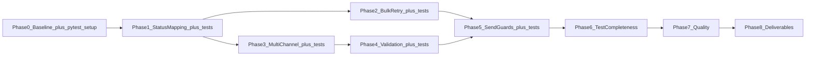

# PLAN.md Review — Quality Assessment and Recommended Updates

This document reviews [PLAN.md](PLAN.md) against the current codebase and lists concrete improvements to apply before implementation begins. **This is a review document only — it does not change application code or PLAN.md itself.**

---

## Executive Summary

| Aspect | Rating | Notes |
|--------|--------|-------|
| Architecture accuracy | Excellent | Diagram and request-flow table match `src/main.py`, `src/storage.py`, `src/processor.py` |
| Bug identification | Excellent | Provider `Result` ignored, bulk filter, first-channel-only — all verified in code |
| Phase breakdown | Very good | Correct dependency order: mapping → bulk → multi-channel → validation → guards |
| Internal consistency | Needs update | Duplicate Section 5; pytest/TDD contradictions across sections |
| Test strategy clarity | Needs update | TDD mandated in decisions but Phase 6 defers all tests to the end |
| Specification completeness | Needs update | `lastError` aggregation, HTTP status codes, create response code |
| Ready to implement? | After doc pass | Apply items below to PLAN.md (~15–30 minutes) |

**Verdict:** PLAN.md is a strong, accurate roadmap. Fix the consistency and specification gaps listed below, then start Phase 0.

---

## What to Keep Unchanged

Do not rewrite these parts of PLAN.md — they are correct and well-scoped:

- **Section 1 — Current Architecture:** Mermaid diagram, request-flow table, design characteristics, status model analysis.
- **Section 2 — Issues, Gaps, and Technical Debt:** Critical bugs table, API/validation gaps, dead code notes, hard constraints.
- **Phase 0 — Baseline:** Goal, acceptance criteria, verification approach. `NOTES.md` already partially satisfies this.
- **Phase 1–2 core logic:** Provider `Result` → status mapping; bulk filter `status in (PENDING, RETRY_PENDING)`.
- **Phase 3 Option A semantics** (status aggregation): SENT if all succeed; RETRY_PENDING if any TemporaryFailure; FAILED otherwise.
- **Phase 4 validation scope:** Create/PUT guards, `smsSegments` recompute on update.
- **Phase 8 — Candidate deliverables:** Hand-written README, ask-before-push.
- **Section 7 — Manual verification checklist:** Structure is good; only update the POST create row (see below).
- **Section 9 — Out of scope:** Accurate as written.

---

## Priority-Ordered Improvements

Apply in this order when editing PLAN.md.

### 1. Merge duplicate Section 5 (highest priority)

**Problem:** Two sections are both numbered "5":

- Lines 355–368: "Unclear Requirements — Clarify Before Coding" (still open)
- Lines 371–403: "Unclear Requirements — Decisions" (resolved)

The open section still recommends "skip pytest unless approved" while decisions require pytest with TDD.

**Action:** Delete the open-questions block (lines 355–368). Replace both Section 5 blocks with a single **Section 5. Resolved Design Decisions** using the table in [Proposed Section 5 Replacement](#proposed-section-5-replacement) below.

---

### 2. Resolve pytest / TDD contradictions

**Problem:** Several sections still treat tests as optional:

| Location in PLAN.md | Currently says | Should say |
|---------------------|----------------|------------|
| Section 3 risks (line 127) | "Phase 6 optional pending approval" | pytest decided for this task; see TDD workflow |
| Phase 6 title (line 295) | "optional, requires approval" | Renamed; see TDD restructuring |
| Section 6 scope (line 423) | "Phase 6 if pytest approved" | Full scope includes tests in every coding phase |
| Files table (lines 451–452) | `tests/*` and `requirements.txt` optional | Required from Phase 0 onward |
| Section 2 line 51 | "No automated tests" | Update after tests are planned |

**Action:** Add to Section 5 decisions:

> **pytest dependency:** Decided for this screening task — add `pytest` to `requirements.txt` without further approval. (AGENTS.md "ask before" is satisfied by this plan decision.)

Update Section 3 risks row for pytest to:

| Risk | Mitigation |
|------|------------|
| Random provider outcomes make deterministic testing hard | Mock `providers.*.send` in unit tests; use manual curl for integration smoke checks |
| Test maintenance burden | Keep tests focused on processor, validation, segmenter; run `pytest` after each phase |

---

### 3. Restructure phases for true TDD (Option A)

**Problem:** Decision #6 requires TDD (failing tests first), but the implementation diagram places Phase 6 after Phase 5 — that is test-after, not TDD.

**Action:** Integrate tests into each coding phase. Rename Phase 6 to **Phase 6 — Test suite completeness** (segmenter edge cases, any gaps).

| Phase | TDD workflow |
|-------|----------------|
| **Phase 0** | Add `pytest` to `requirements.txt`; create `tests/` with `conftest.py` (fixtures for `Notification`, mocked providers) |
| **Phase 1** | Write `tests/test_processor_status_mapping.py` (failing) → implement `_apply_provider_response` / mapping in `processor.py` → green |
| **Phase 2** | Write `tests/test_processor_bulk.py` (failing) → update `send_all()` filter → green |
| **Phase 3** | Write `tests/test_processor_multichannel.py` (failing) → implement channel iteration + Option A aggregation → green |
| **Phase 4** | Write `tests/test_validation.py` (failing) → implement create/PUT validation → green |
| **Phase 5** | Write `tests/test_send_guards.py` (failing) → implement 409 for `sent` resend → green |
| **Phase 6** | Add `tests/test_segmenter.py`; run full suite; fill coverage gaps only |

**Update Phase 1–5 sections:** Add a **TDD steps** bullet list at the top of each phase (write failing test → implement → run `pytest`).

**Replace Section 6 diagram** with the version in [Updated Implementation Order](#updated-implementation-order) below.

**Update recommended scope line:**

```text
Recommended full scope: Phases 0–7 (tests written alongside each coding phase), then Phase 8 deliverables.
```

---

### 4. Document multi-channel `lastError` aggregation (Phase 3)

**Problem:** Option A defines final **status** but not **lastError** when multiple channels return different outcomes.

**Action:** Add to Phase 3 acceptance criteria and Section 5 decisions:

**`lastError` aggregation rule (Option A):**

- On **SENT:** clear `lastError` (per Decision #4).
- On **RETRY_PENDING** or **FAILED:** set `lastError` to all non-success provider `Message` values, joined with `"; "` (semicolon + space), in `targetChannels` order. Providers already prefix messages with `[email]`, `[sms]`, `[push]` — preserve those prefixes.
- Example: SMS temporary + email permanent → status `retry_pending`, `lastError` = `"[sms] temporary outage; [email] address rejected"`.
- If a channel has unknown type, include `"Unknown channel: <type>"` in the joined string and treat as failure for aggregation.

---

### 5. Clarify HTTP semantics (Phase 5 + Section 5)

**Problem:** 409 for resend of `sent` is decided, but other HTTP behavior is unspecified.

**Action:** Add these decisions to Section 5 and reference them in Phase 5:

| Endpoint / case | HTTP status | Response body |
|-----------------|-------------|---------------|
| `POST /notifications/<id>/send` — delivery ends `sent`, `retry_pending`, or `failed` | **200** | Updated notification object (unchanged success-path shape) |
| `POST /notifications/<id>/send` — notification already `sent` | **409** | `{ "error": "notification already sent" }` (or similar) |
| `POST /notifications/<id>/send` — not found | **404** | `{ "error": "not found" }` (existing) |
| `POST /notifications` — valid create | **200** | New notification object (keep Flask default; do not change to 201 without API approval) |
| `POST /notifications` — validation failure | **400** | `{ "error": "..." }` |
| `PUT /notifications/<id>` — disallowed field | **400** | `{ "error": "..." }` |

**Update Section 7 checklist row:**

| Check | Expected |
|-------|----------|
| `POST /notifications` valid body | **200** with new id, `smsSegments` set when SMS present |

---

### 6. Remove stale "pending confirmation" references

**Action:**

- Phase 3 line 212: Change `**Recommended strategy (pending confirmation — see Section 5):**` to `**Strategy (resolved — Option A, see Section 5):**`
- Remove Options B and C from Phase 3 body, or collapse to a single line: "Options B/C rejected — see Section 5."
- Phase 5 lines 277–279: Remove "Recommended / Alternative" — state decided policy: allow resend of `retry_pending` and `failed`; reject `sent` with 409.
- Section 3 risk row for multi-channel: Change mitigation to "Option A documented in Section 5."

---

### 7. Minor technical notes (optional but recommended)

**`attempts` on pre-send failures**

`send_one` increments `attempts` before checking empty `targetChannels` (`processor.py:13–18`). PLAN.md should note:

- **Decision:** Keep current behavior (attempt counts any send invocation, including immediate failures). Document in Phase 1 acceptance criteria.

**Phase 4 timing**

Diagram shows Phase 4 parallel to Phases 1–3; Phase 4 text says "best after Phase 1–3." Pick one:

- **Recommendation:** Phase 4 runs after Phase 3 (validation after delivery logic is stable). Update diagram: `P3 --> P4 --> P5`.

**Section 1 intro line**

Change "open questions" to "resolved decisions and phased work" in the opening paragraph once Section 5 is merged.

**Formatting**

Decision items 2–7 in current PLAN.md (lines 377–403) use inconsistent markdown — use the table format in the proposed Section 5 below.

---

## Proposed Section 5 Replacement

Replace both current Section 5 blocks with:

```markdown
## 5. Resolved Design Decisions

All ambiguities below are resolved for this implementation. Reference this section from phases instead of re-opening questions.

| # | Topic | Decision | Rationale |
|---|-------|----------|-----------|
| 1 | Multi-channel send | **Option A** — all channels must succeed for `sent`; any `TemporaryFailure` → `retry_pending`; else `failed` | Notification is one logical delivery across all configured channels |
| 2 | Resend policy | Reject resend of `sent` with **HTTP 409**; allow resend of `retry_pending` and `failed` | Prevents duplicate external delivery |
| 3 | Max retry attempts | No cap — `retry_pending` retried via manual send or bulk | Keeps in-memory implementation simple |
| 4 | `lastError` on success | Clear on `sent`; set on `retry_pending` / `failed` only | Avoids misleading error state after success |
| 5 | `smsSegments` | Display-only metadata; no validation gate | Informational; not billing enforcement |
| 6 | Automated tests | **pytest required**; **TDD per phase** (failing test → implement → green); mock providers in unit tests | Deterministic coverage; `pytest` approved for this task |
| 7 | API error format | `{ "error": "message" }` for 400, 404, 409 | Predictable client error handling |
| 8 | Multi-channel `lastError` | Join non-success messages with `"; "` in channel order | Preserves all failure context |
| 9 | Send HTTP on delivery failure | **200** with updated notification body (`failed` / `retry_pending` are valid send outcomes) | Success path response shape unchanged |
| 10 | POST create status code | **200** (Flask default) | No API response format change without approval |

### TDD workflow (applies to Phases 1–5)

1. Write failing pytest cases for the phase scope.
2. Implement minimal code to pass.
3. Run `pytest` before starting the next phase.
4. Phase 6 adds segmenter tests and closes any coverage gaps.
```

---

## Updated Implementation Order

Replace Section 6 mermaid diagram and scope lines with:

```markdown
## 6. Suggested Implementation Order



**Minimum viable improvement (MVP):** Phases 0 → 1 → 2 (each with tests) → manual verification → Phase 8 README.

**Recommended full scope:** Phases 0–7 (TDD integrated per phase), then Phase 8 deliverables.
```

---

## Global Search-and-Replace Checklist

When editing PLAN.md, search for these strings and update:

| Search | Replace / action |
|--------|------------------|
| `Phase 6 is optional pending approval` | Remove; point to Section 5 Decision #6 |
| `optional, requires approval` (Phase 6 title) | `Test suite completeness` |
| `Phase6_Tests_optional` (diagram node) | `Phase6_TestCompleteness` |
| `with Phase 6 if pytest approved` | `with tests integrated in Phases 1–5 and Phase 6 completeness pass` |
| `tests/*` \| 6 (optional) | `tests/*` \| 0–6 (required) |
| `requirements.txt` \| 6 (optional, with approval) | `requirements.txt` \| 0 (pytest; decided) |
| `skip pytest unless approved` | Delete (contradicts decisions) |
| `201/200` (checklist) | `200` |
| `pending confirmation — see Section 5` | `resolved — Option A, see Section 5` |
| `open questions` (intro) | `resolved decisions` |

---

## Updated Files Expected to Change (Section 8)

Suggested revision for the files table:

| File | Phases |
|------|--------|
| `src/processor.py` | 1, 2, 3, 5, 7 |
| `src/main.py` | 4, 5 |
| `src/storage.py` | 4 (`smsSegments` on update) |
| `src/validation.py` | 4 (optional new file) |
| `tests/*` | 0–6 (required) |
| `requirements.txt` | 0 (`pytest`; decided) |
| `README.md` | 8 (candidate hand-written) |
| `PLAN.md` | Apply this review |
| **`src/providers/*`** | **Never** |

---

## Bottom Line

PLAN.md correctly identifies what is broken and proposes the right fix order. Before writing code:

1. Merge Section 5 into one decisions table.
2. Align all pytest/TDD language with Decision #6.
3. Pair tests with Phases 1–5 (true TDD).
4. Specify `lastError` aggregation and HTTP status codes.
5. Remove stale open questions and "optional" test language.

After these edits, PLAN.md is ready to drive implementation starting at Phase 0.
